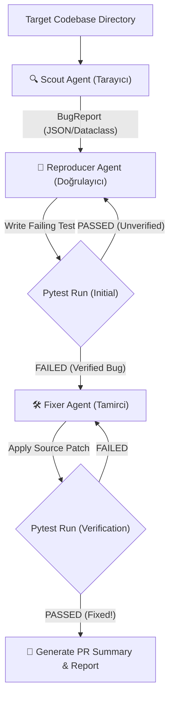

# 🛡️ Self-Healing Bug Hunter (Google GenAI Multi-Agent System)

[](https://www.python.org/)
[](https://pypi.org/project/google-genai/)
[](LICENSE)

**Self-Healing Bug Hunter**, resmi `google-genai` Python SDK altyapısı (`gemini-2.5-flash`) üzerinde çalışan; açık kaynak projelerdeki mantık hatalarını, bellek/kaynak sızıntılarını, tip uyuşmazlıklarını ve güvenlik açıklarını otonom olarak tespit eden, doğrulayan ve otomatik tamir eden çoklu ajanlı bir yazılım geliştirme sistemidir.

---

## 🏗️ 1. Ajan Mimarisi ve Rol Dağılımı

Sistem 3 temel uzman ajanın asenkron (`async/await`) boru hattı üzerinden haberleşmesiyle çalışır:

| Ajan (Agent) | Rolü | Görevi ve Sorumluluğu |
| :--- | :--- | :--- |
| **🔍 Scout Agent** | Tarayıcı | Belirtilen kod dizinini titizlikle tarayarak mantık hataları, kaynak sızıntıları ve tip uyumsuzluklarını tespit eder. `BugReport` nesnesi üretir. |
| **🧪 Reproducer Agent** | Doğrulayıcı | Scout Agent'ın bulduğu hatayı doğrulamak amacıyla, mevcut koda karşı kesin olarak **BAŞARISIZ (failing)** olan bir `pytest` unit testi yazar (`TestReproduction`). |
| **🛠️ Fixer Agent** | Tamirci | Kaynak koda müdahale ederek hatayı tamir eder, unit testlerin **BAŞARILI (passing)** olduğunu teyit eder ve PR açıklamasını oluşturur (`FixResult`). |

---

## 📐 2. Şematik Akış Şeması (Data Flow Architecture)

### Mermaid Akış Şeması


### ASCII Akış Özeti
```text
[ Target Codebase ]
         │
         ▼
 ┌────────────────┐      BugReport       ┌────────────────────┐
 │  Scout Agent   │ ───────────────────> │  Reproducer Agent  │
 └────────────────┘                      └────────────────────┘
                                                   │
                                            Failing Unit Test
                                                   │
                                                   ▼
 ┌────────────────┐       FixResult      ┌────────────────────┐
 │  Pull Request  │ <─────────────────── │    Fixer Agent     │
 └────────────────┘                      └────────────────────┘
```

---

## 📁 3. Proje Dosya Yapısı

```text
self_healing_bug_hunter/
├── agents/
│   ├── __init__.py
│   ├── scout.py          # Scout Agent (Tarayıcı) tanımı
│   ├── reproducer.py     # Reproducer Agent (Doğrulayıcı) tanımı
│   └── fixer.py          # Fixer Agent (Tamirci) tanımı
├── sample_target/
│   └── buggy_calculator.py # Gösterim amaçlı kasıtlı hatalı hedef dosya
├── config.py             # Ajan istemleri, GenAI SDK ayarları ve veri modelleri
├── tools.py              # Dosya okuma/yazma ve pytest çalıştırma araçları
├── orchestrator.py       # Asenkron boru hattı yöneticisi (BugHunterOrchestrator)
├── main.py               # Ana uygulama çalıştırma dosyası
├── .env.example          # Ortam değişkeni şablonu
├── .gitignore            # Git dışlama kuralları
├── LICENSE               # MIT Lisansı
└── README.md             # Dokümantasyon ve mimari özet
```

---

## ⚡ 4. Kurulum ve Çalıştırma

### 1. Depoyu Klonlayın
```bash
git clone https://github.com/KULLANICI_ADINIZ/self_healing_bug_hunter.git
cd self_healing_bug_hunter
```

### 2. Bağımlılıkları Yükleyin
```bash
pip install google-genai pytest
```

### 3. Gemini API Key Tanımlayın
[Google AI Studio](https://aistudio.google.com/app/apikey) üzerinden `AIzaSy...` formatında aldığınız API anahtarını ortam değişkenine ekleyin:

**Windows PowerShell:**
```powershell
$env:GEMINI_API_KEY="AIzaSy_YOUR_API_KEY_HERE"
```

**Linux / macOS:**
```bash
export GEMINI_API_KEY="AIzaSy_YOUR_API_KEY_HERE"
```

### 4. Sistemi Çalıştırın
```bash
python main.py
```

---

## 📄 Lisans
Bu proje [MIT Lisansı](LICENSE) kapsamında lisanslanmıştır.
