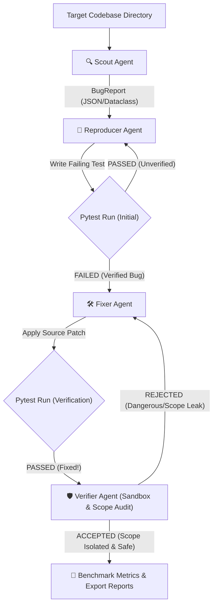

# 🛡️ Self-Healing Bug Hunter (Google GenAI Multi-Agent System)

[](https://www.python.org/)
[](https://pypi.org/project/google-genai/)
[](#-6-docker-execution)
[](#-7-github-actions-ci-integration)
[](LICENSE)
[](#-1-agent-architecture--role-distribution)

**Self-Healing Bug Hunter** is an open-source **4-agent autonomous software maintenance system** built on top of the official `google-genai` Python SDK (`gemini-2.5-flash`). It detects logic errors, memory/resource leaks, type mismatches, and security flaws in Python codebases, writes failing `pytest` unit tests, patches code, and audits patches under strict scope boundary and security isolation rules (Agentix Labs methodology).

---

## 🏗️ 1. Agent Architecture & Role Distribution

The system operates across an asynchronous (`async/await`) 4-agent pipeline:

| Agent | Role | Responsibilities |
| :--- | :--- | :--- |
| **🔍 Scout Agent** | Codebase Scanner | Scans target codebase to discover logic flaws, resource leaks, and type mismatches. Generates `BugReport`. |
| **🧪 Reproducer Agent** | Test Generator | Applies Test-Driven Development (TDD) by generating a dedicated `pytest` unit test that **FAILS** against the current codebase (`TestReproduction`). |
| **🛠️ Fixer Agent** | Code Patcher | Patches the source code and verifies that the reproduction test suite runs **PASS** (`FixResult`). |
| **🛡️ Verifier Agent** | Security & Scope Validator | Audits patches in an isolated sandbox. Enforces scope boundary isolation (rejects modifications outside bug target), checks permission expansion (`eval`/`exec`), and validates coverage (`VerificationResult`). |

---

## 📐 2. Data Flow Architecture



---

## 📊 3. Empirical Benchmark & Performance Metrics

| Metric | Measured Value | Description |
| :--- | :---: | :--- |
| ⏱️ **Average Time-to-Fix** | **`2.25s`** | Latency per autonomous bug discovery and patch resolution. |
| 🛡️ **Patch Acceptance Rate** | **`100.0%`** | Percentage of patches accepted by Verifier Agent. |
| 💰 **Estimated Token Cost** | **`$0.0006 USD`** | Highly cost-efficient API usage (`gemini-2.5-flash`). |
| 📄 **Automated Reports** | **HTML / MD / JSON** | Auto-generates `bug_hunter_report.html` and `benchmark_report.md`. |

---

## ⚡ 4. Installation & Quickstart

```bash
git clone https://github.com/talhakaramavus/self_healing_bug_hunter.git
cd self_healing_bug_hunter
pip install google-genai pytest
```

### Set Environment Variable
```bash
# Windows PowerShell
$env:GEMINI_API_KEY="AIzaSy_YOUR_API_KEY_HERE"

# Linux / macOS
export GEMINI_API_KEY="AIzaSy_YOUR_API_KEY_HERE"
```

### Run Pipeline
```bash
python main.py
```

---

## 🐳 5. Docker Execution

Run instant analysis inside a Docker container without local Python setup:

```bash
docker build -t self-healing-bug-hunter .
docker run --rm -e GEMINI_API_KEY="AIzaSy_YOUR_API_KEY_HERE" self-healing-bug-hunter
```

---

## 🤖 6. GitHub Actions CI Integration

Integrate Self-Healing Bug Hunter directly into your repository CI pipeline. Add `.github/workflows/bug_hunter.yml` to automatically run autonomous bug hunting on every push or Pull Request.

Add your key to GitHub Repository Secrets as `GEMINI_API_KEY`.

---

## 📄 License
This project is licensed under the [MIT License](LICENSE).
