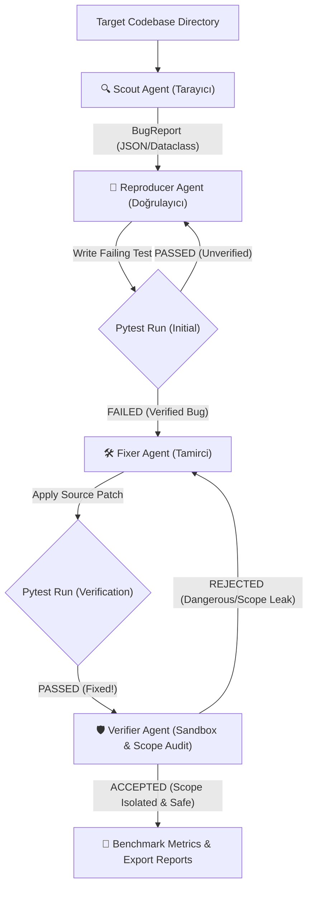

# 🛡️ Self-Healing Bug Hunter (Google GenAI Multi-Agent System)

[](https://www.python.org/)
[](https://pypi.org/project/google-genai/)
[](LICENSE)
[](#-1-ajan-mimarisi-ve-rol-dağılımı)

**Self-Healing Bug Hunter**, resmi `google-genai` Python SDK altyapısı (`gemini-2.5-flash`) üzerinde çalışan; açık kaynak projelerdeki mantık hatalarını, bellek/kaynak sızıntılarını, tip uyuşmazlıklarını ve güvenlik açıklarını otonom olarak tespit eden, doğrulayan, tamir eden ve dar kapsamlı yetki/güvenlik sınırları (Agentix Labs yaklaşımı) ile denetleyen **4-Ajanlı** bir yazılım geliştirme sistemidir.

---

## 🏗️ 1. Ajan Mimarisi ve Rol Dağılımı

Sistem 4 temel uzman ajanın asenkron (`async/await`) boru hattı üzerinden haberleşmesiyle çalışır:

| Ajan (Agent) | Rolü | Görevi ve Sorumluluğu |
| :--- | :--- | :--- |
| **🔍 Scout Agent** | Tarayıcı | Belirtilen kod dizinini titizlikle tarayarak mantık hataları, kaynak sızıntıları ve tip uyumsuzluklarını tespit eder. `BugReport` üretir. |
| **🧪 Reproducer Agent** | Doğrulayıcı | Scout Agent'ın bulduğu hatayı doğrulamak amacıyla, mevcut koda karşı kesin olarak **BAŞARISIZ (failing)** olan bir `pytest` unit testi yazar (`TestReproduction`). |
| **🛠️ Fixer Agent** | Tamirci | Kaynak koda müdahale ederek hatayı tamir eder, unit testlerin **BAŞARILI (passing)** olduğunu teyit eder ve PR açıklamasını oluşturur (`FixResult`). |
| **🛡️ Verifier Agent** | Güvenlik & Kapsam Doğrulayıcı | Yamayı izole bir sandbox ortamında çalıştırır. İlgisiz dosyaların değiştirilmesini engeller (Scope Boundary), yetki genişletmelerini (Permission Expansion/eval/exec) denetler ve kabul kriterlerini doğrular (`VerificationResult`). |

---

## 📐 2. Şematik Akış Şeması (Data Flow Architecture)

### Mermaid Akış Şeması


---

## 📊 3. Benchmark & Performans Değerlendirme Metrikleri

Sistem çalıştırıldıktan sonra aşağıdaki performans metriklerini otomatik olarak hesaplar ve `benchmark_report.md` / `benchmark_report.json` olarak kaydeder:

- **Gerçek Pozitifler (True-Positives):** Doğrulanan gerçek hataların sayısı.
- **Yanlış Alarmlar (False Alarms):** Hatalı tespit edilen alarmların sayısı.
- **Yama Kabul Oranı (Patch Acceptance Rate %):** Verifier Agent tarafından kabul edilen güvenli yamaların yüzdesi.
- **Ortalama Tamir Süresi (Time-to-Fix):** Hata başına ortalama tamirat ve doğrulama süresi (saniye).
- **Tahmini Token Maliyeti ($ USD):** İşlem boyunca harcanan tahmini API token maliyeti.

---

## 📁 4. Proje Dosya Yapısı

```text
self_healing_bug_hunter/
├── agents/
│   ├── __init__.py
│   ├── scout.py          # Scout Agent (Tarayıcı)
│   ├── reproducer.py     # Reproducer Agent (Doğrulayıcı)
│   ├── fixer.py          # Fixer Agent (Tamirci)
│   └── verifier.py       # Verifier Agent (Güvenlik & Kapsam Doğrulayıcı)
├── sample_target/
│   └── buggy_calculator.py # Gösterim amaçlı kasıtlı hatalı hedef dosya
├── tests/
│   └── test_bug_hunter.py# Çerçeve doğrulama testleri
├── config.py             # Sistem istemleri ve veri modelleri
├── tools.py              # Dosya ve Pytest çalıştırıcı araçları
├── logger.py             # Renkli terminal loglama modülü
├── reporter.py           # HTML, Markdown ve JSON rapor üreticisi
├── benchmark.py          # Performans ve Benchmark değerlendirme modülü
├── orchestrator.py       # 4-Ajanlı asenkron boru hattı yöneticisi
├── main.py               # Ana CLI çalıştırma betiği
├── .env.example          # Ortam değişkeni şablonu
├── .gitignore            # Git dışlama kuralları
├── LICENSE               # MIT Lisansı
└── README.md             # Dokümantasyon ve mimari özet
```

---

## ⚡ 5. Kurulum ve Çalıştırma

### 1. Depoyu Klonlayın
```bash
git clone https://github.com/talhakaramavus/self_healing_bug_hunter.git
cd self_healing_bug_hunter
```

### 2. Bağımlılıkları Yükleyin
```bash
pip install google-genai pytest
```

### 3. Gemini API Key Tanımlayın
[Google AI Studio](https://aistudio.google.com/app/apikey) üzerinden `AIzaSy...` formatında aldığınız API anahtarını ortam değişkenine ekleyin:

**Windows PowerShell:**
```powershell
$env:GEMINI_API_KEY="AIzaSy_YOUR_API_KEY_HERE"
```

**Linux / macOS:**
```bash
export GEMINI_API_KEY="AIzaSy_YOUR_API_KEY_HERE"
```

### 4. Sistemi Çalıştırın
```bash
# Varsayılan hedef dizin üzerinde çalıştırma:
python main.py

# Özel bir hedef kod dizini ile çalıştırma:
python main.py --target-dir "C:/path/to/your/project"
```

---

## 📄 Lisans
Bu proje [MIT Lisansı](LICENSE) kapsamında lisanslanmıştır.
